  

  

 

<picture>
  <source media="(prefers-color-scheme: light)" srcset="./assets/h-about-light.svg" />
  
</picture>

I'm **Mads**, a <!-- AGE_START -->20<!-- AGE_END -->-year-old **IT Operations Coordinator** from Norway, working with infrastructure, servers and system management day to day.

I sit somewhere between **AI**, **operations** and **development**. I like the practical side of tech: getting systems to run properly, figuring out *why* they fail, and making my setup cleaner every time I tear it down and rebuild it.

Outside work I run a small homelab and use AI for pretty much everything. Not to skip the work, but to learn faster, build faster, debug faster, and turn random ideas into projects that actually run.

 

<picture>
  <source media="(prefers-color-scheme: light)" srcset="./assets/h-status-light.svg" />
  
</picture>

  

<picture>
  <source media="(prefers-color-scheme: light)" srcset="./assets/h-build-light.svg" />
  
</picture>

Things that have come out of that loop so far:

| | |
| --- | --- |
| **Remappr** | Keyboard remapping tool for Windows |
| **suno-songsmith** | A Claude skill that turns song ideas into release-ready Suno material |
| **Anime discovery site** | A full browser/discovery website for finding new shows |
| **MP4 downloader** | Small YouTube-link-to-MP4 experiment |
| **Homelab tooling** | Scripts and helpers for very specific problems I created myself |

 

<picture>
  <source media="(prefers-color-scheme: light)" srcset="./assets/h-career-light.svg" />
  
</picture>

  

<picture>
  <source media="(prefers-color-scheme: light)" srcset="./assets/h-stack-light.svg" />
  
</picture>

  

 

<picture>
  <source media="(prefers-color-scheme: light)" srcset="./assets/h-projects-light.svg" />
  
</picture>

  
  
  
  

 

**Latest pushes**

<!-- REPOS_START -->
- [`dailybulk`](https://github.com/RealBombi/dailybulk) - No description yet.
- [`RealBombi`](https://github.com/RealBombi/RealBombi) - No description yet.
- [`suno-songsmith`](https://github.com/RealBombi/suno-songsmith) - A Claude skill that turns a song or album idea into release-ready Suno material: Style prompts, structured lyrics with metatags, genre-switch songs, and album planning.
- [`Remappr`](https://github.com/RealBombi/Remappr) - Remappr - Keyboard remapping tool for Windows
- [`premium-ui-builder`](https://github.com/RealBombi/premium-ui-builder) - No description yet.
<!-- REPOS_END -->

Most of my AI and homelab experiments live privately, so this is the tip of the iceberg.

  

<picture>
  <source media="(prefers-color-scheme: light)" srcset="./assets/h-activity-light.svg" />
  
</picture>

<picture>
  <source media="(prefers-color-scheme: dark)" srcset="https://raw.githubusercontent.com/RealBombi/RealBombi/output/snake-dark.svg" />
  <source media="(prefers-color-scheme: light)" srcset="https://raw.githubusercontent.com/RealBombi/RealBombi/output/snake-light.svg" />
  
</picture>

 

